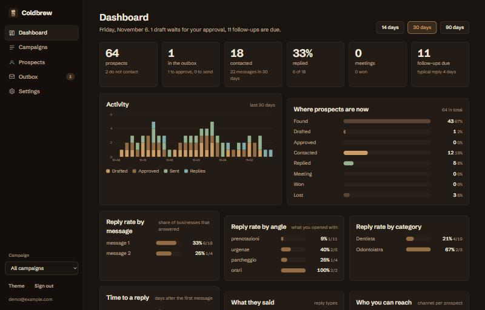
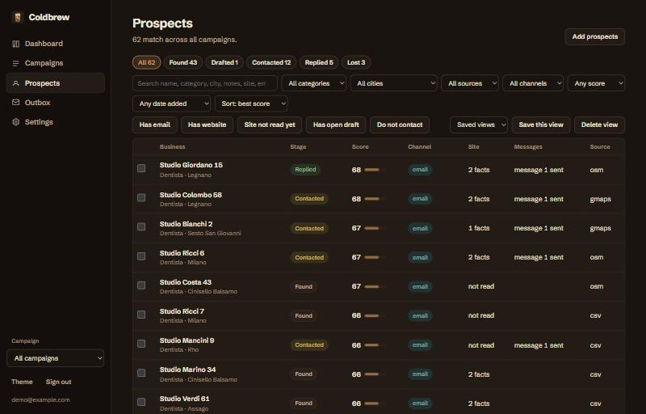

# Coldbrew

*Approval-first outreach for local businesses.*

An open-source app that runs on your own computer. It builds a ranked list of businesses in a city, helps you write a short
honest first message to each one, holds every draft until you approve it, reads the replies back, and shows what works.
**It never sends anything itself.** You send from your own mail or Instagram.



*Screenshots use synthetic demo data (`npm run demo`).*

## Why it exists

Cold outreach tools optimise for volume. Coldbrew optimises for being a person who noticed something specific about a
business and asked one real question. The method is enforced in code, so it holds on a tired Friday too:

- **A linter for the method.** One observation, one question, under 75 words (40 for bumps), an honest lowercase subject of
  2 to 5 words, no template phrases or spam triggers, no em dashes, no links in the first email, and no number that is not in
  your profile or on their own website. Italian and English.
- **Approval you can trust.** A draft must pass the linter before you can approve it. Editing an approved draft takes the
  approval back, so what you send is what you approved. Every step is logged.
- **A permanent do-not-contact list**, checked before a draft can even be created. Opt-out replies are never stored and
  exclude the business for good; angry or legal replies are kept as received and never answered.
- **Facts with sources.** What you can mention comes from the business's own public website, each with a link to where it says so.
  If nothing specific is found, Coldbrew says so rather than guessing.

## Quick start

Needs [Node.js](https://nodejs.org) 22.13 or newer.

```bash
git clone https://github.com/ahmedmetered/coldbrew.git && cd coldbrew
npm install        # only for reading replies over IMAP (imapflow, mailparser); skip it if you do not want that
npm start          # http://localhost:7679
npm run demo       # optional: a demo database with synthetic data, then DB_FILE=data/demo.db npm start
```

Create a local account, make a campaign (a kind of business in a place, plus who you are and what you may truthfully claim),
then add prospects.

## How it works

1. **Campaign.** A vertical in a place, with a profile: sender, offer, the only claims allowed, the opt-out line, and which categories count.
2. **Find prospects.** OpenStreetMap (free, no key, one query per municipality), the Google Maps scraper, or any CSV. The scraper
   (gosom, in Docker) can be run from the app, or you can import its CSV. Duplicates merge, filters run before ranking, and the
   score favours businesses you can actually reach.
3. **Read their site.** At most three pages of the business's own site, robots.txt respected, for email, phone, social links and things worth mentioning.
4. **Draft.** From a template, by hand, with an optional model (Ollama locally, or your own key), or with the AI agent you already use: "Copy brief for my AI agent" hands it the facts, limits and rules (see `skills/outreach`, the Harvey-derived method). Always linted.
5. **Approve and send.** Approved drafts open in your mail app or copy to the clipboard. You send, then press "I sent it".
6. **Follow-ups.** Message 2 around day 5, message 3 around day 10, a breakup around day 14, each waiting for your approval. A reply ends the sequence.
7. **Replies.** Read-only IMAP, and optionally Instagram (Instagram API with Instagram Login, read-only), match replies to prospects and classify them (interested, question, objection, wrong person, not interested, opt-out, angry or legal). Instagram does nothing until you connect a token.
8. **Daily digest.** What needs you today (replies, drafts to approve, messages to send, follow-ups due, never message text), on the dashboard and optionally pushed to your phone through ntfy.sh, Discord or Slack.
9. **Dashboard.** Funnel, activity, reply rate by message, angle and category, time to a reply, reply types, channels, prospect quality and source yield.



The prospect list keeps its filters at hand: search, stage, category, city, source, channel, score, date added, has email or
website, site not read yet, open drafts, do-not-contact, saved views and bulk actions.

## What the data sources really give

OpenStreetMap shows that a business exists and where. In a real test, 49 dentists in central Turin came back with only 3 websites,
3 emails and 7 phone numbers. So the Google Maps scraper's CSV is the rich source, and OpenStreetMap is the Docker-free way to
discover businesses, followed by reading each business's own site.

## Privacy and security

- Everything is stored in `data/app.db` on your machine. `GET /api/export` downloads all of it; deleting your account removes it.
- Mailbox and AI-key secrets are encrypted with AES-256-GCM using a key in `data/secret.key`. That protects a copied database file, not someone who can read both files.
- Mailboxes are opened read-only: nothing is flagged, moved, deleted or sent.
- The server listens on `127.0.0.1` only. Passwords use scrypt, sessions are random tokens stored hashed, cookies are `HttpOnly` and `SameSite=Lax`, cross-origin writes are rejected, and all UI text is set through `textContent`.
- Business data goes to an AI provider **only** if you configure one and press a draft button.

## Responsible use

Prospect data is personal data in many countries. You are responsible for lawful use: a genuine reason to write to each business,
a working opt-out honoured immediately, and lists used for your own outreach, never resold. Coldbrew guards the common rules but
cannot know your recipient's situation. This is not legal advice.

## Project layout

| Path | Job |
|---|---|
| `src/sources.mjs`, `src/enrich.mjs`, `src/normalize.mjs`, `src/rank.mjs` | Sources, reading a business's site, dedupe, filter and score (pure parts tested with fixtures) |
| `src/lint.mjs`, `src/draft.mjs`, `src/ai.mjs` | The method as code, templates, optional model drafts |
| `src/core.mjs` | Campaigns, prospects, do-not-contact, drafts and approval, follow-ups, the dashboard numbers |
| `src/replies.mjs`, `src/mail.mjs`, `src/mailutil.mjs`, `src/instagram.mjs` | Reply classification and matching, read-only IMAP, read-only Instagram |
| `src/scrape.mjs`, `src/digest.mjs` | Running the Google Maps scraper in Docker, the daily digest and its webhook |
| `src/server.mjs`, `src/db.mjs`, `src/auth.mjs`, `src/secrets.mjs`, `src/scheduler.mjs` | API, SQLite schema, accounts, encryption, mailbox checks |
| `public/index.html` | The whole interface in one file, no framework, no build step |
| `scripts/` | `demo-seed.mjs` (synthetic data), `import-anydeals.mjs` (move over an anydeals tracker) |

```bash
npm test     # no network, a few seconds
```

Successor to [anydeals](https://github.com/ahmedmetered/anydeals), the agent-skill version of the same method. Design notes are in [DESIGN.md](DESIGN.md).

## Honest limits

Inbox and Instagram reading are tested against recorded responses, not a live account. The scraper runner is tested with a fake Docker; it needs Docker running. Google Maps data is a snapshot with gaps by construction, so treat a missing phone or website as "not found", not "does not exist".

## License

MIT, see [LICENSE](LICENSE).
